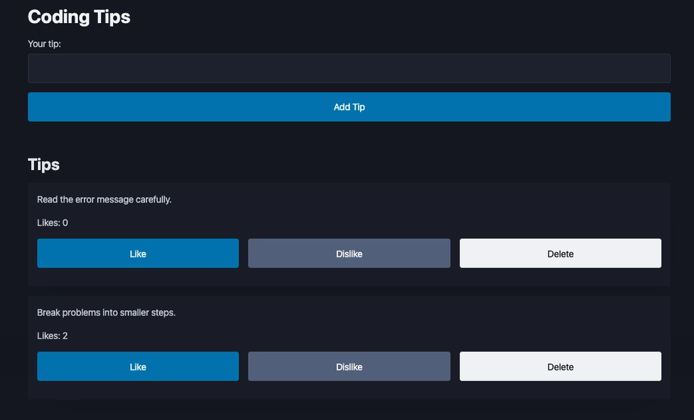
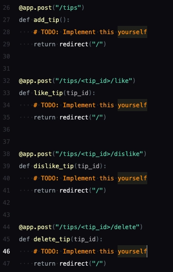

# Coding Tips Lab

For this lab, we are going to try to move from the raw python http server library we’ve been using so far to a slightly nicer-to-work-with framework called Flask.

Start by downloading the starter code below, unzipping it, and then running it with `uv run app.py`. If the visit in your browser the following url: `http://127.0.0.1:3000` you should be able to see the same as the screenshot above.

## Part 1:

Notice that if you press the `Like`, `Dislike`, or `Delete` buttons, along with `Add Tip`, nothing is currently working. This is the part that you need to handle.

In the code, you will need to implement:

Keep the redirect at the end, and replace the `TODO` with your logic. For the `add_tip` method, you probably want to look at the flask documentation for how to access the body of the incoming request. That should contain the tip `text` inside of it. For each of these tasks, you want to make changes to the list that contains the tips.

## Part 2:

Once you are done with Part 1, you should be able to see your app successfully adding tips, deleting tips, etc. The problem is, if we shutdown the server and restart it, all the tips are reset as well. Find a way to implement the `save_tips()` function so that you can call it after each mutation and persist the tips. Make sure that when the user first opens the app, you check if there are any tips in the file and read them into your application as well. Now, when you shutdown the server and turn it back on, the tips should still be there.
