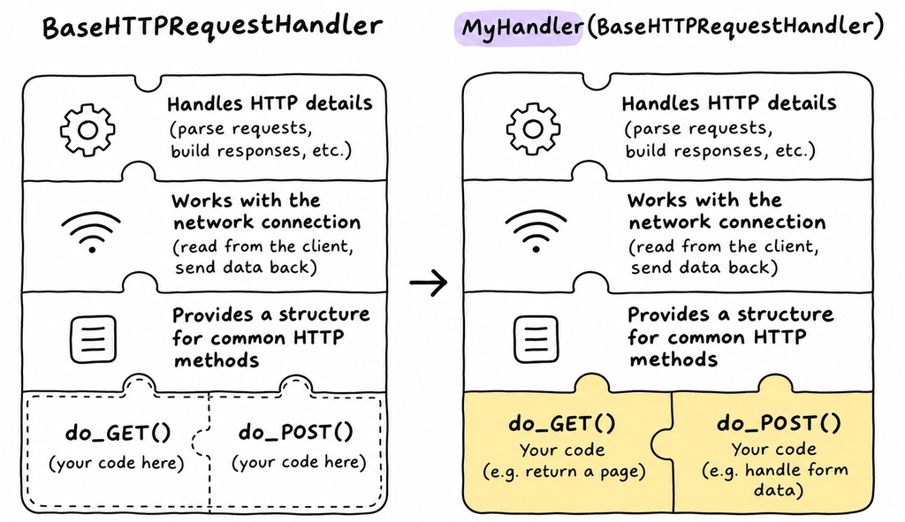
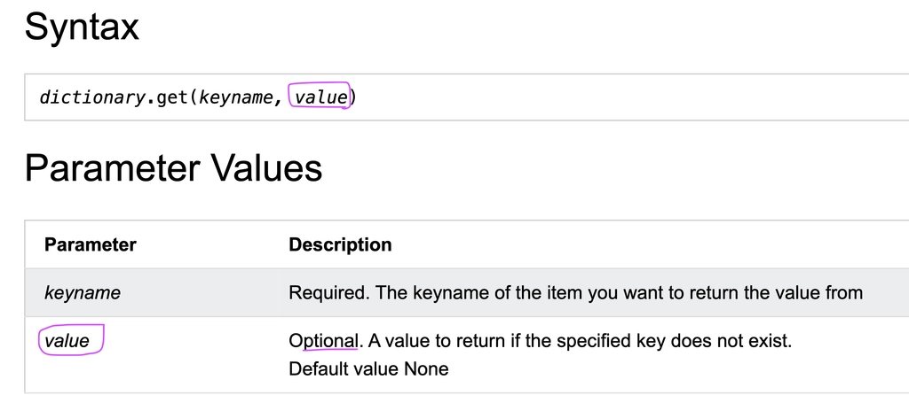

# Networking in Python

# HTTP Web Servers in Python

Note from Armaan: In these notes, we're going to take a look at building HTTP web servers using Python's standard library. We won't be using Flask, Django, FastAPI, or any other frameworks. The goal is to understand how web servers actually work before introducing abstractions. We'll start with a server that returns plain text, then gradually add HTML, routing, files, forms, JSON, and other features.

## What is a web server?

A web server is simply a program that listens for HTTP requests and sends back HTTP responses.

For example, when you visit `http://localhost:3000` in your browser:

1.  Your browser sends an HTTP request to port 3000 on your computer.
2.  A web server listening on that port receives the request.
3.  The server processes it and sends back an HTTP response.
4.  Your browser receives the response and displays the result.

An HTTP response might look something like this:

```txt
HTTP/1.1 200 OK
Content-Type: text/plain
Content-Length: 12

Hello World!
```

A response consists of a status line, headers, a blank line, and an optional body.

A few things to know:

- **HTTP** is the protocol used for communication between the client and server.
- **localhost** refers to your own computer (we talked about this in class).
- **3000** is the port number our server will listen on.
- **GET** is an HTTP method typically used to retrieve information.
- **200 OK** is a status code indicating that the request was successful.

## Creating our first web server

Python comes with a module called `http.server`.

Two classes we're interested in:

- `HTTPServer`: Creates the server and listens for requests.
- `BaseHTTPRequestHandler`: Lets us define what happens when an HTTP request arrives.

So the way things work is Python gives us a *mostly* complete web server. As you can see below, there’s a `class` that Python has implemented for us called `BaseHTTPRequestHandler`. You’ll learn more about classes in your object oriented programming course in upcoming terms, but for now, just know that it contains “most” of the core logic required to construct a web server. Our class, `MyHandler`, inherits all of that, but provides its own implementation for what happens when a user tries to **get** something from us or tries to **post** (send) something to us.



Above is a quick scribble of what we discussed during lecture. The `BaseHTTPRequestHandler` has 2 slots it keeps open for us to fill in *ourselves* in our `MyHandler` class. Those two puzzle pieces at the bottom in yellow are the functions that *you* are responsible for filling out when you make a web server in python.

Create a file called `server.py`:

```python
from http.server import HTTPServer, BaseHTTPRequestHandler

class MyHandler(BaseHTTPRequestHandler):
    def do_GET(self):
        self.send_response(200)
        self.end_headers()
        self.wfile.write(b"Hello World!")

server = HTTPServer(("localhost", 3000), MyHandler)
server.serve_forever()
```

Run the file:

```txt
python server.py
```

Open your browser and visit:

`http://localhost:3000`

You should see `Hello World!`. Pretty cool!

As mentioned in class, if you need to stop the server, press `Ctrl+C` in the terminal. (You’ll need to restart the server any time you change the code).

### Breaking down the code above:

**`HTTPServer(("localhost", 3000), MyHandler)`**

This line creates an HTTP server that listens on localhost, port 3000. We're also telling Python to use `MyHandler` whenever an HTTP request arrives.

**`do_GET(self)`**

This method is automatically called whenever the server receives a GET request. If we wanted to handle POST requests, we would implement `do_POST()` instead.

**`self.send_response(200)`**

Sends the HTTP status code `200 OK`.

**`self.end_headers()`**

Marks the end of the HTTP response headers. After calling this, we can start writing the response body.

**`self.wfile.write(...)`**

Writes bytes to the response body.

**`server.serve_forever()`**

Keeps the server running, continuously listening for incoming requests. Without this, our program would terminate instead of continuing to serve requests.

## Why are we using bytes?

Notice this line:

```python
self.wfile.write(b"Hello World!")
```

Why is there a `b` before the string? It’s because `self.wfile.write()` expects bytes, not a Python string.

In other words, this wouldn’t work:

```python
self.wfile.write("Hello World!")
```

Instead, we can either use a bytes literal:

```python
self.wfile.write(b"Hello World!")
```

Or encode a regular string:

```python
message = "Hello World!"

self.wfile.write(message.encode("utf-8"))
```

Both approaches produce the same result in this example. Remember, data transmitted over a network is ultimately represented as bytes. Python strings need to be encoded before they can be written to a network stream.

## Returning HTML instead of plain text

Let's make our server return an actual HTML page.

```python
from http.server import HTTPServer, BaseHTTPRequestHandler

class MyHandler(BaseHTTPRequestHandler):
    def do_GET(self):
        html = """
        <html>
            <body>
                <h1>Hello BCIT!</h1>
                <p>This is my first Python web server.</p>
            </body>
        </html>
        """

        self.send_response(200)
        self.send_header("Content-Type", "text/html")
        self.end_headers()

        self.wfile.write(html.encode("utf-8"))

server = HTTPServer(("localhost", 3000), MyHandler)
server.serve_forever()
```

The main difference is this line:

```python
self.send_header("Content-Type", "text/html")
```

We're telling the browser that the response contains HTML.

The browser will parse that HTML and render it as a web page.

If we changed the content type to `text/plain`, the browser would generally display the HTML tags as text instead of rendering them.

### Some common Content-Type values

| Content-Type | Used for |
|---|---|
| text/plain | Plain text |
| text/html | HTML |
| text/css | CSS |
| application/javascript | JavaScript |
| application/json | JSON |
| image/png | PNG images |

> 🤖 Heads up from Armaan: The types above that web servers use to signal the type of content they’re serving are called “MIME Types”. You can see a more complete list of them below:
> 
> <https://developer.mozilla.org/en-US/docs/Web/HTTP/Guides/MIME_types/Common_types>

## HTTP headers

HTTP headers carry additional information about a request or response.

For example:

```txt
HTTP/1.1 200 OK
Content-Type: text/html
Content-Length: 26

<h1>Hello from Python!</h1>
```

In Python, we can set these headers using `send_header()`.

```python
class MyHandler(BaseHTTPRequestHandler):
    def do_GET(self):
        body = b"Hello World!"

        self.send_response(200)
        self.send_header("Content-Type", "text/plain")
        self.send_header("Content-Length", str(len(body)))
        self.end_headers()

        self.wfile.write(body)
```

Notice that we call `end_headers()` after setting all our headers. The `Content-Length` header specifies the size of the response body in **bytes**, not characters.

## Understanding self.path

How does the server know which URL the browser requested?

We can access the requested path using `self.path`.

```python
from http.server import HTTPServer, BaseHTTPRequestHandler

class MyHandler(BaseHTTPRequestHandler):
    def do_GET(self):
        print("Requested path:", self.path)

        self.send_response(200)
        self.end_headers()
        self.wfile.write(b"Check the terminal!")

server = HTTPServer(("localhost", 3000), MyHandler)
server.serve_forever()
```

Try visiting these URLs:

```txt
http://localhost:3000/
http://localhost:3000/about
http://localhost:3000/students
http://localhost:3000/students?id=5
```

You'll see something like:

```txt
Requested path: /
Requested path: /about
Requested path: /students
Requested path: /students?id=5
```

Notice that `self.path` also includes the query string, if one exists.

## Basic routing

Let's create a website with three different pages.

We can use `if` statements to check the requested path.

```python
from http.server import HTTPServer, BaseHTTPRequestHandler

class MyHandler(BaseHTTPRequestHandler):
    def do_GET(self):
        if self.path == "/":
            html = "<h1>Home Page</h1>"

        elif self.path == "/about":
            html = "<h1>About Page</h1>"

        elif self.path == "/contact":
            html = "<h1>Contact Page</h1>"

        else:
            self.send_error(404, "Page not found")
            return

        self.send_response(200)
        self.send_header("Content-Type", "text/html")
        self.end_headers()

        self.wfile.write(html.encode("utf-8"))

server = HTTPServer(("localhost", 3000), MyHandler)
server.serve_forever()
```

Try:

```txt
http://localhost:3000/
http://localhost:3000/about
http://localhost:3000/contact
http://localhost:3000/hello
```

The last URL should return a 404 error because we haven't defined a route for `/hello`.

This is essentially what server-side routing is: examining the requested URL and deciding what code to execute. Frameworks like Flask and FastAPI provide cleaner ways to define routes, but the underlying idea is the same.

## Working with files in Python

Before we serve HTML files, let's quickly review how to read and write files in Python.

### Writing to a file

```txt
file = open("bcit.txt", "w")
file.write("Hello")
file.close()
```

This creates a file called `bcit.txt` and writes the string `Hello`.

If the file already exists, opening it with `"w"` replaces its contents.

### Reading a file

```python
file = open("bcit.txt", "r")
content = file.read()
file.close()
print(content)
```

Output:

```txt
Hello
```

### Reading a file as bytes

```python
file = open("bcit.txt", "rb")
content = file.read()
file.close()

print(content)
print(content.decode("utf-8"))
```

Output:

```txt
b'Hello'
Hello
```

The difference between `"r"` and `"rb"`:

- `"r"` reads the file as text and gives us a string.
- `"rb"` reads the file as binary data and gives us bytes.

### Using with open()

Normally, we use a `with` statement so Python automatically closes the file.

```python
with open("bcit.txt", "w") as file:
    file.write("Hello")

with open("bcit.txt", "r") as file:
    content = file.read()

print(content)
```

The file is closed automatically when the `with` block finishes, even if something goes wrong inside the block.

### Using pathlib

Python also has a built-in module called `pathlib`, which makes working with files and paths easier.

```python
from pathlib import Path

file = Path("bcit.txt")

file.write_text("Hello")

print(file.read_text())
print(file.read_bytes())
```

Output:

```txt
Hello
b'Hello'
```

We'll use `pathlib` for some of our server examples.

## Serving an HTML file

So far, we've been writing HTML directly inside our Python code. That's fine for testing, but normally we'd store HTML in a separate file. Let's create the following files:

**index.html**

```html
<!DOCTYPE html>
<html>
<head>
    <title>My Website</title>
</head>
<body>
    <h1>Welcome!</h1>
    <p>This page is being served by Python.</p>
</body>
</html>
```

**server.py**

```python
from http.server import HTTPServer, BaseHTTPRequestHandler
from pathlib import Path

class MyHandler(BaseHTTPRequestHandler):
    def do_GET(self):
        html = Path("index.html").read_bytes()

        self.send_response(200)
        self.send_header("Content-Type", "text/html")
        self.end_headers()

        self.wfile.write(html)

server = HTTPServer(("localhost", 3000), MyHandler)
server.serve_forever()
```

Run `server.py`.

Now when someone visits `http://localhost:3000`, Python reads `index.html` and sends its contents back to the browser. We used `read_bytes()` because `self.wfile.write()` expects bytes. We could have used `read_text()` instead, but then we would need to encode the string before sending it.

## Serving multiple HTML files

Let's add another page.

**index.html**

```html
<!DOCTYPE html>
<html>
<body>
    <h1>Home Page</h1>
    <a href="/contact.html">Contact Us</a>
</body>
</html>
```

**contact.html**

```html
<!DOCTYPE html>
<html>
<body>
    <h1>Contact Us</h1>
    <p>Email: hello@example.com</p>
    <a href="/">Home</a>
</body>
</html>
```

**server.py**

```python
from http.server import HTTPServer, BaseHTTPRequestHandler
from pathlib import Path

class MyHandler(BaseHTTPRequestHandler):
    def do_GET(self):
        if self.path == "/":
            filename = "index.html"

        elif self.path == "/contact.html":
            filename = "contact.html"

        else:
            self.send_error(404)
            return

        html = Path(filename).read_bytes()

        self.send_response(200)
        self.send_header("Content-Type", "text/html")
        self.end_headers()

        self.wfile.write(html)

server = HTTPServer(("localhost", 3000), MyHandler)
server.serve_forever()
```

When the user clicks the Contact Us link, the browser sends another GET request to `/contact.html`. The server sees that path, reads the corresponding HTML file, and sends it back.

## Reading query parameters

Suppose we want to support this URL:

```txt
http://localhost:3000/greet?name=Minsu
```

We want the server to respond with:

```txt
Hello Minsu!
```

Python's `urllib.parse` module can help us parse URLs.

```python
from http.server import HTTPServer, BaseHTTPRequestHandler
from urllib.parse import urlparse, parse_qsl

class MyHandler(BaseHTTPRequestHandler):
    def do_GET(self):
        url = urlparse(self.path)
        params = dict(parse_qsl(url.query))

        name = params["name"]

        self.send_response(200)
        self.end_headers()

        self.wfile.write(f"Hello {name}!".encode("utf-8"))

server = HTTPServer(("localhost", 3000), MyHandler)
server.serve_forever()
```

Let's look at what these functions do.

```python
url = urlparse("/greet?name=Minsu&age=20")

print(url.path)   # /greet
print(url.query)  # name=Minsu&age=20
```

Then:

```python
params = parse_qsl(url.query)
print(params)
```

Output:

```txt
[('name', 'Minsu'), ('age', '20')]
```

`parse_qsl()` returns a list of key-value tuples.

## Handling POST requests

So far, our servers have only handled GET requests. Let's handle POST. We simply implement a method called `do_POST()`.

```python
from http.server import HTTPServer, BaseHTTPRequestHandler

class MyHandler(BaseHTTPRequestHandler):
    def do_POST(self):
        self.send_response(200)
        self.end_headers()

        self.wfile.write(b"POST request received!")

server = HTTPServer(("localhost", 3000), MyHandler)
server.serve_forever()
```

## Reading the POST request body

When a client sends a POST request, it can include data in the request body.

For example:

```txt
POST /students HTTP/1.1
Host: localhost:3000
Content-Type: text/plain
Content-Length: 5

Minsu
```

We can read the request body using `self.rfile`.

```python
from http.server import HTTPServer, BaseHTTPRequestHandler

class MyHandler(BaseHTTPRequestHandler):
    def do_POST(self):
        length = int(self.headers["Content-Length"])

        body = self.rfile.read(length)

        print(body)
        print(body.decode("utf-8"))

        self.send_response(200)
        self.end_headers()

        self.wfile.write(b"Data received!")

server = HTTPServer(("localhost", 3000), MyHandler)
server.serve_forever()
```

There are two important attributes to remember:

- `self.rfile`: A stream that we can read incoming request-body bytes from.
- `self.wfile`: A stream that we can write outgoing response-body bytes to.

We read exactly the number of bytes specified in `Content-Length`.

This simple example assumes the client sends a valid length. In a real application, we'd also need to validate the size and handle malformed requests.

## Returning JSON

Web servers don't necessarily need to return HTML.

A backend server might return JSON for a frontend application to consume.

Python has a built-in `json` module.

```python
from http.server import HTTPServer, BaseHTTPRequestHandler
import json

class MyHandler(BaseHTTPRequestHandler):
    def do_GET(self):
        students = [
            {"id": 1, "name": "Mina"},
            {"id": 2, "name": "Minsu"}
        ]

        data = json.dumps(students)

        self.send_response(200)
        self.send_header("Content-Type", "application/json")
        self.end_headers()

        self.wfile.write(data.encode("utf-8"))

server = HTTPServer(("localhost", 3000), MyHandler)
server.serve_forever()
```

When you visit `http://localhost:3000`, the response body will contain:

```txt
[
    {"id": 1, "name": "Mina"},
    {"id": 2, "name": "Minsu"}
]
```

A reminder about the `json` module:

```python
import json

student = {"name": "Minsu", "age": 20}

# Python object -> JSON string
json_string = json.dumps(student)

# JSON string -> Python object
python_object = json.loads(json_string)
```

`json.dumps()` serializes a Python object into a JSON string.

`json.loads()` parses a JSON string into a Python object.

## Receiving JSON

Let's make a server that accepts JSON through a POST request.

```python
from http.server import HTTPServer, BaseHTTPRequestHandler
import json

class MyHandler(BaseHTTPRequestHandler):
    def do_POST(self):
        length = int(self.headers["Content-Length"])

        body = self.rfile.read(length)

        student = json.loads(body)

        print(student)
        print(student["name"])

        self.send_response(201)
        self.send_header("Content-Type", "application/json")
        self.end_headers()

        response = {"message": "Student created"}

        self.wfile.write(json.dumps(response).encode("utf-8"))

server = HTTPServer(("localhost", 3000), MyHandler)
server.serve_forever()
```

Test it:

```bash
curl -X POST http://localhost:3000 \
  -H "Content-Type: application/json" \
  -d '{"name":"Minsu","age":20}'
```

Server output:

```json
{'name': 'Minsu', 'age': 20}
Minsu
```

Response:

```json
{"message": "Student created"}
```

Notice that we're returning status code `201 Created`, which is commonly used when a new resource has been created. This example assumes the request contains valid JSON with a `name` property. Later, we could add error handling for invalid input.

## Handling an HTML form

Let's make a basic HTML form that submits data to our Python server.

**index.html**

```html
<!DOCTYPE html>
<html>
<body>
    <h1>Student Registration</h1>

    <form action="/register" method="POST">
        <input type="text" name="name" placeholder="Your name">
        <button type="submit">Register</button>
    </form>
</body>
</html>
```

**server.py**

```python
from http.server import HTTPServer, BaseHTTPRequestHandler
from pathlib import Path
from urllib.parse import parse_qsl
from html import escape

class MyHandler(BaseHTTPRequestHandler):
    def do_GET(self):
        html = Path("index.html").read_bytes()

        self.send_response(200)
        self.send_header("Content-Type", "text/html")
        self.end_headers()

        self.wfile.write(html)

    def do_POST(self):
        length = int(self.headers["Content-Length"])
        body = self.rfile.read(length).decode("utf-8")

        data = dict(parse_qsl(body))
        name = data["name"]

        html = f"<h1>Welcome, {escape(name)}!</h1>"

        self.send_response(200)
        self.send_header("Content-Type", "text/html")
        self.end_headers()

        self.wfile.write(html.encode("utf-8"))

server = HTTPServer(("localhost", 3000), MyHandler)
server.serve_forever()
```

When you submit the form, the browser sends the form data to `/register` using POST.

By default, HTML forms encode their data as `application/x-www-form-urlencoded`.

For example:

```txt
name=Minsu
```

For multiple fields:

```txt
name=Minsu&age=20
```

We're using `parse_qsl()` to eventually convert this data into a Python dictionary. We're also using `html.escape()` before inserting user input into HTML. This prevents a user's name from being interpreted as HTML markup.

## HTTP status codes

You've already seen a few status codes in our examples.

Here's a quick reference:

| Status Code | Meaning |
|---|---|
| 200 | OK |
| 201 | Created |
| 204 | No Content |
| 301 | Moved Permanently |
| 302 | Found / Redirect |
| 400 | Bad Request |
| 401 | Unauthorized |
| 403 | Forbidden |
| 404 | Not Found |
| 405 | Method Not Allowed |
| 500 | Internal Server Error |

Returning a status code:

```python
self.send_response(200)
self.end_headers()
```

Returning an error:

```python
self.send_error(404, "Page not found")
```

Redirecting a user:

```python
self.send_response(302)
self.send_header("Location", "/")
self.end_headers()
```

The last example tells the browser to navigate to `/`.

## Avoiding repeated code

You might have noticed that we're writing these lines over and over:

```python
self.send_response(200)
self.send_header("Content-Type", "text/plain")
self.end_headers()
self.wfile.write(b"Hello!")
```

We can create a helper method to clean things up.

```python
from http.server import HTTPServer, BaseHTTPRequestHandler

class MyHandler(BaseHTTPRequestHandler):
    def send_text(self, text, status=200):
        body = text.encode("utf-8")

        self.send_response(status)
        self.send_header("Content-Type", "text/plain")
        self.send_header("Content-Length", str(len(body)))
        self.end_headers()

        self.wfile.write(body)

    def do_GET(self):
        if self.path == "/":
            self.send_text("Welcome!")

        elif self.path == "/about":
            self.send_text("About us")

        else:
            self.send_text("Not found", 404)

server = HTTPServer(("localhost", 3000), MyHandler)
server.serve_forever()
```

Now we're not repeating the same HTTP response logic in every route. We could also make helpers such as `send_html()` and `send_json()`.

## Check your Understanding: Practice exercises

> 🤖 Note from Armaan: None of these exercises are “due”, meaning you don’t have to submit them. That being said, I highly recommend that you do them, as it will be difficult to understand the upcoming weeks material without practice.

**Exercise 1: Hello Server**

Create a web server that listens on port 3000 and returns:

```txt
Hello BCIT!
```

---

**Exercise 2: Multiple routes**

Create the following routes:

```txt
/           -> Welcome to my website!
/about      -> This is the about page.
/contact    -> Contact us at hello@bcit.ca
```

Return a 404 response for all other paths.

---

**Exercise 3: Query parameters**

Create a `/greet` route that accepts a name through the query string.

Example:

```txt
/greet?name=Luke
```

Response:

```txt
Hello Luke!
```

If no name is provided, respond with `Hello Guest!`.

**Hint from Armaan:**



---

**Exercise 4: HTML pages**

Create an HTML website containing:

- `index.html`
- `about.html`
- `contact.html`

Use Python to serve these files and add links so users can navigate between the pages.

---

**Exercise 5: JSON API**

Create a `/students` endpoint that returns a list of three students as JSON.

Each student should have an `ID`, `name`, and `age`.

---

**Exercise 6: POST requests**

Create a POST endpoint at `/students`.

The client should be able to send JSON containing a student's `name` and `age`.

Your server should parse the JSON and print the student's information to the terminal.

---

## Quick reference

Here are some handy lines of code that can help you with the exercises above if you need some reminders:

```python
# Import HTTP server functionality
from http.server import HTTPServer, BaseHTTPRequestHandler

# Start a server
server = HTTPServer(("localhost", 3000), MyHandler)
server.serve_forever()

# Send a successful response
self.send_response(200)
self.end_headers()

# Send a header
self.send_header("Content-Type", "text/html")

# Send a response body
self.wfile.write(b"Hello!")

# Read the requested path
self.path

# Read a request header
self.headers["Content-Type"]

# Read a request body (when Content-Length is valid)
length = int(self.headers["Content-Length"])
body = self.rfile.read(length)

# Return a 404
self.send_error(404)

# Parse JSON
import json
data = json.loads(body)

# Convert a Python object to JSON
json.dumps(data)

# Read a file
from pathlib import Path
Path("index.html").read_bytes()
```
